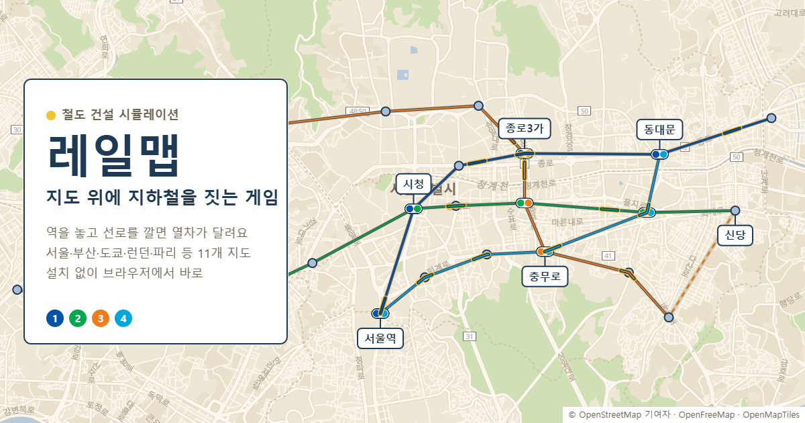

# 레일맵

**실제 도시 지도 위에 역을 놓고 선로를 깔면 열차가 달리는 철도 건설 게임**이에요. 설치 없이 브라우저에서 바로 할 수 있어요.

▶ **바로 해 보기: https://kutanxx.github.io/railmap/**



## 어떤 게임인가요

- **진짜 지도에서**: 서울·부산·인천·대구·대전·광주, 도쿄·오사카·뉴욕·시카고·런던·파리, 그리고 땅 높이와 산·강이 있는 가상 지도 "솔내 지방"까지 13개 지도
- **사람이 많은 곳에 역을**: 역 주변 건물 면적으로 인구를 재고, 두 역 사이 승객은 인구가 많고 가까울수록 늘어나요
- **선로와 노선**: 역을 이어 선로를 깔고(직선·곡선), 역을 골라 노선을 만들면 열차가 자동으로 오가요. 강을 건너면 교량, 산을 뚫으면 터널이라 공사비가 달라요
- **광역급행과 고속철도역**: 노선을 GTX 같은 광역급행으로 만들면 빠르게 멀리 나르고, 서울역·도쿄역 같은 고속철도역 옆에 역을 지으면 기차 타는 사람들까지 승객이 돼요
- **돈 관리**: 매달 운임 수입에서 운영비가 빠져요. 빚은 한도까지 낼 수 있고, 너무 오래 한도 아래에 있으면 파산해요. 나라마다 요금 방식이 달라요 (서울 거리 비례, 도쿄 거리 구간, 런던 구역제, 뉴욕·파리 균일)
- **보는 재미**: 혼잡도 색칠, 지하철 노선도 보기(그림 저장), 달마다 통계 그래프, 어두운 관제실 모드, 가까이 보면 승강장과 출구까지
- **편의 기능**: 되돌리기·다시 하기, 계획 선로(돈 없이 그려 두기), 역·노선 찾기, 자동 저장, 샌드박스(돈 무제한), 링크로 노선망 공유, 실제 지하철 노선망(서울·도쿄·런던·파리 등 11개 도시)을 미리 깐 샌드박스로 시작하기

## 조작법

| 키 | 하는 일 |
| --- | --- |
| 1 · 2 · 3 · 4 | 선택 · 역 놓기 · 선로 · 노선 도구 |
| Space | 멈춤 / 다시 가기 |
| V · P | [선로] 도구에서 직선↔곡선 · 계획 선로 |
| C · D · N | 혼잡도 보기 · 노선도 보기 · 관제실 모드 |
| / · H | 역·노선 찾기 · 버튼 숨기고 지도만 보기 |
| Ctrl+Z · Ctrl+Y | 되돌리기 · 다시 하기 |
| Esc · 오른쪽 클릭 | 그리던 것 취소 |

처음 열면 튜토리얼이 역 → 선로 → 노선 → 열차 출발을 안내해요. 게임 안의 [?] 버튼에서 전체 조작법을 다시 볼 수 있어요.

> 컴퓨터(마우스·키보드)에서 가장 편하고, 휴대폰·태블릿에서도 손가락으로 할 수 있어요 (두 손가락으로 지도 움직이기·키우기, 한 손가락으로 고른 역 옮기기, 왼쪽 아래 ↶ ↷).
> 저장은 각자의 브라우저에 돼요. 다른 컴퓨터로 옮기려면 [메뉴] → [내보내기]로 파일을 받아 [불러오기] 하세요.

## 내 컴퓨터에서 실행하기

[Node.js](https://nodejs.org/)가 있으면:

```bash
npm install
npm run dev
```

터미널에 나온 주소(보통 http://localhost:5173)를 브라우저로 열면 돼요. `npm run build`로 만든 `dist` 폴더는 어느 정적 사이트에나 올릴 수 있어요 ([docs/deploy.md](docs/deploy.md)). 이 저장소는 `main`에 올리면 GitHub Pages로 저절로 다시 올라가요.

## 만든 방법

- 순수 JavaScript + [Vite](https://vite.dev/), 지도는 [MapLibre GL JS](https://maplibre.org/), 거리·선 계산은 [Turf.js](https://turfjs.org/)
- 소리와 배경 음악은 파일 없이 Web Audio로 직접 만들어요
- 코드 구조, 아트 규칙, 게임 규칙은 [CLAUDE.md](CLAUDE.md)에 정리돼 있어요
- 프로그래밍을 배우지 않은 주인이 방향을 정하고, AI(Claude)가 코드를 쓰는 방식으로 만들었어요

## 지도 자료 출처

- 지도: © [OpenStreetMap](https://www.openstreetmap.org/copyright) 기여자, [OpenMapTiles](https://openmaptiles.org/), 지도 타일은 [OpenFreeMap](https://openfreemap.org/)
- 화면 글꼴: [Pretendard](https://github.com/orioncactus/pretendard) (SIL Open Font License 1.1)
- 역 이름은 지도에 적힌 동네 이름에서 따와요. 실제 노선 이름과 색의 출처는 [src/lineColors.js](src/lineColors.js) 맨 위에 적혀 있어요. 실제 노선망의 역 순서·자리·선로 모양도 OpenStreetMap 자료예요 ([tools/make-presets.mjs](tools/make-presets.mjs))
